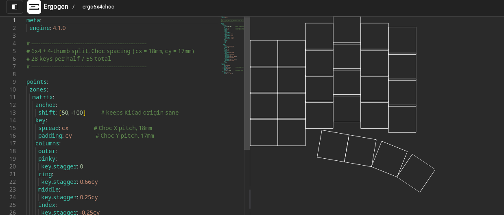

# Eclectronics Final Proposal - Conway's Game of Life Keyboard
Eddy Pan

For this project, I will design a custom PCB in KiCAD with the help of [Ergogen](https://ergogen.xyz/) to design the keyboard layout, and I will write the firmware for Conway's Game of Life atop [QMK](https://qmk.fm/). Currently, I plan for no other contributors towards this project. I may try to rope in some of my MechE friends to help me CAD the frame. I plan to design and manufacture as much of this project as possible. Alongside designing the PCB and writing the firmware, I will assemble the PCB myself, undergo board bringup, 3D print the keycaps, CAD and print the frame, then assemble the product together. This project is inspired in large part from this [GitHub repo](https://github.com/christianselig/caldera-keyboard).

The goal of this keyboard is to improve the longevity of my hands as I continue with engineering and constant laptop use. My design will be ergonomic with many of the features existing off-the-shelf ergonomic keyboards use. I'd rather design my own PCB because I know that I have smaller hands. What I produce from this semester will be version 1 of this project. I plan on building out future versions of this keyboard with more features like bluetooth, battery power, and modularity switching between wired and wireless.  

This first version of the keyboard will feature two boards, each with 28 keys. They will be connected to the host computer over USB-C, and connected to each other over another USB-C port. They will be reporting the keyboard input over the USB. Each key will have a WS2812 RGB LED underneath connected in series. The onboard MCU will control the logic for Conway's Game of Life based on the keyboard input. I'll also have a switch to control different modes of the Game of Life, such as one game that rotates through the HSV color wheel, three games on each of the RGB channels, one game on one color, and disabling the game of life completely.

Currently, I'm planning on using either the RP2354A or the STM32L432KB as my main microcontroller. I am hesitant to embed it directly on the PCB--I'm considering developing a daughter board that breaks out the MCU instead, as I'm okay with it being a little higher on just its own two layers. With the board broken out, it helps with the geometry of the keyboard to make it more ergonomic as well as give me the freedom to switch out the MCU and pinout in the future. 

First draft ergokb setup in ergogen
